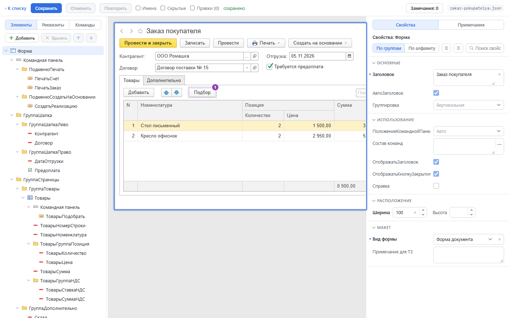
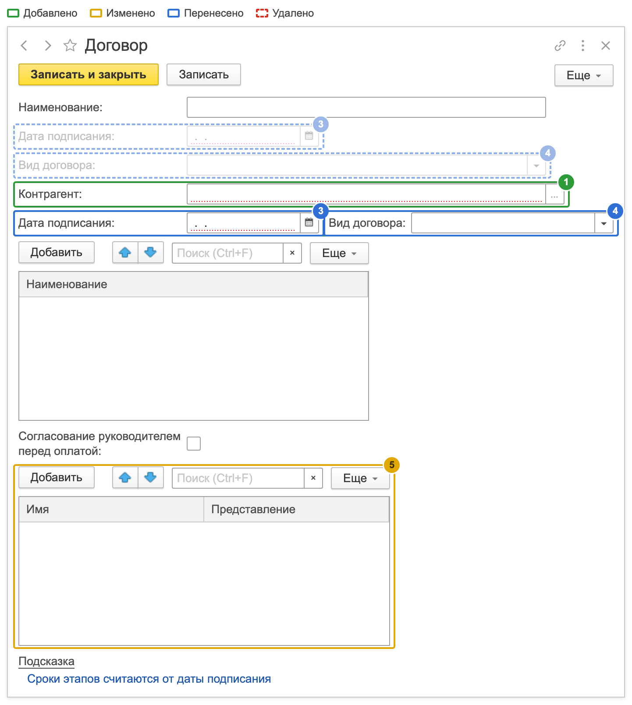
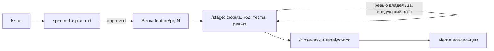

# edt1c-ai-template

**Шаблон проекта 1С:Предприятие в EDT, с которым Claude Code пишет код по стандартам 1С, работает от спецификации и проверяет себя сам.**

[](LICENSE)


Агент без правил пишет на BSL код, который компилируется: запрос в цикле, реквизит через точку, `Сообщить()`, форма «как получилось». Ловить это потом приходится на ревью, и каждый раз заново.

Шаблон кладёт в репозиторий то, что агенту нужно знать до первой строки кода: стандарты 1С, порядок работы от спеки до коммита, роли проверяющих и инструменты, через которые агент видит модель EDT, а не текст файлов. Клонируете, отвечаете на вопросы инициализации - и проект готов к работе с Claude Code.

## Что вы получаете

- 📚 **Стандарты 1С, которые агент читает сам** - 26 документов: код и запросы, антипаттерны, строгая типизация, асинхронность, формы «Такси» и «Версия 8.5», БСП, рефакторинг, ревью. `CLAUDE.md` даёт к ним маршрут: что держать в голове всегда, куда смотреть по теме.
- 📝 **Спека первой (SDD)** - значимое изменение начинается со `spec.md`, у каждого критерия приёмки есть способ проверки. Код - только после согласования, расхождение с кодом правит спеку тем же PR.
- 👥 **Цикл этапа субагентами** - основная сессия держит задачу и решения, форму собирает верстальщик, код пишет исполнитель, тесты YAxUnit - тестировщик, проверяет ревьюер со свежим контекстом. Владелец видит этап, который уже прошёл одну проверку (`/stage`).
- 🔌 **Работа через модель EDT** - MCP-сервер [EDT-MCP](https://github.com/DitriXNew/EDT-MCP) (или [codepilot1c](https://github.com/ondysss/codepilot1c-edt) на EDT старше 2026.1): метаданные, формы, диагностика, проверка запросов, отладчик, прогон YAxUnit. Справочник с таблицей «ответ инструмента → действие», чтобы агент не принимал «не найдено» за «нет».
- 🖼️ **Макеты форм для ТЗ** - новое, подробнее [ниже](#макеты-форм-для-тз).
- 🧰 **Скрипты проверок** - механика диффа одним проходом (тире, вложенные вызовы, имена), аудит форм по стандартам, прогон YAxUnit в рабочей базе, сравнение собранных `epf`/`erf`/`cfe`, замер расхода токенов этапа.
- 🔁 **Шаблон живёт вместе с проектами** - `/sync-template` забирает обновления стандартов, `/push-to-template` поднимает правку из проекта обратно с заменой префикса и чисткой проектной специфики.
- ✅ **Ритуалы задачи** - `/close-task` закрывает задачу по чек-листу и останавливается перед merge, `/analyst-doc` пишет документ для аналитика и тестировщика: что изменилось глазами пользователя и в каком порядке проверять.

## Макеты форм для ТЗ

Аналитику нужна картинка формы в ТЗ, разработчику - понятный список правок. Инструмент [`tools/form-mockup/`](tools/form-mockup/) даёт и то и другое: картинку формы в интерфейсе «Такси», страницу HTML, которая открывается без сети, и таблицу элементов для текста ТЗ.



Три сценария, и в каждом его ведёт агент по скиллу `/form-mockup`:

1. **Форма по описанию задачи** - «нарисуй форму заявки на закупку: шапка, табличная часть, согласование».
2. **Существующая форма по XML** - `Form.form` из EDT или `Form.xml` из выгрузки конфигуратора превращается в макет, а отчёт импорта показывает, что перенесено.
3. **Доработка «было / стало»** - на картинке видно, что добавлено, перенесено, изменено и удалено, а таблица изменений с теми же номерами уходит в текст ТЗ.



Доводка руками - в конструкторе в браузере, устроенном как редактор формы в конфигураторе: дерево элементов, реквизиты, команды, свойства, перетаскивание, отмена. Импорт из 1С показывает дерево объектов конфигурации, а окна выбора типа, картинки и цвета берут их из исходников конфигурации и её расширений.

Аналитику терминал не нужен: ярлык «Открыть макеты» для Windows и Mac, двойной щелчок - и открывается список макетов папки. Нужны только Python 3.9+ и Chrome (на Windows подойдёт Edge). Как пользоваться - [`tools/form-mockup/README.md`](tools/form-mockup/README.md).

Настоящую форму в EDT инструмент не собирает и `.form` не правит: макет - для согласования, а форма в EDT собирается инструментами MCP на этапе разработки.

## Быстрый старт

Создайте пустой каталог, запустите в нём Claude Code и дайте одну задачу:

> Склонируй `https://github.com/vandalsvq/edt1c-ai-template.git` в текущий каталог (`git clone <url> .`) и выполни инструкцию из `docs/project-init.md`.

Дальше Claude ведёт сам: спросит про `git`, попросит создать EDT-проект, заполнит `CLAUDE.md` и `README.md` под ваш проект, выберет MCP-сервер по версии EDT, подключит нужные скиллы и удалит ненужные. Промпт идемпотентен - можно запускать повторно.

Используете свой fork - подставьте его URL. Каталог должен быть пустым: `git clone <url> .` на непустой папке падает.

<details>
<summary><b>Установка вручную, по шагам</b></summary>

### 1. Склонируйте шаблон

```bash
cp -r edt1c_ai_template my-project
cd my-project
rm -rf .git && git init
```

Или «Use this template» на GitHub и `git clone <url>`.

### 2. Создайте EDT-проект

В EDT: `File → New → 1C:Enterprise project`. Имя - на латинице (`<Каталог>.<НазваниеПроекта>`), префикс объектов (например, `prj_`), тип (`Configuration` / `Configuration extension` / `Library`), расположение - корень репозитория.

Этот шаг делается через GUI EDT и не автоматизируется промптом: Claude берёт из созданного каталога имя, префикс и платформу.

### 3. Запустите промпт инициализации

Откройте Claude Code в корне репозитория и скажите:

> Выполни инструкцию из `docs/project-init.md`.

Промпт проведёт через остальные шаги:

- заполнит `CLAUDE.md` под проект (имя, тип, префикс, платформа, ветки, коммиты);
- адаптирует `README.md` (заголовок, описание, ссылки);
- выберет MCP-сервер по версии EDT (EDT-MCP или codepilot1c), проверит подключение, при необходимости подскажет команду подключения;
- подключит skill `bsl-check` (по `docs/bsl-check-setup.md`) или удалит его, если не нужен;
- спросит, нужны ли навыки `skd-*` / `mxl-*`, документ для аналитика и макеты форм `form-mockup`; ненужное удалит;
- создаст `.claude/settings.local.json` из примера;
- очистит примеры из `planning/examples/`;
- по желанию создаст первый коммит и удалит сам себя.

Подробности - в [`docs/project-init.md`](docs/project-init.md).

</details>

## Как идёт задача



1. **Issue → спека → код**, не наоборот.
2. На каждое значимое изменение - папка `specs/<prefix>-<N>/` с `spec.md` + `plan.md` из `_template/`; задача с циклом этапа берёт оттуда же `questions.md`, `decisions.md`, `log.md`.
3. Спека согласуется (`draft` → `approved`), и только потом начинается код в ветке `feature/<prefix>-<N>`.
4. Расхождение кода и спеки разрешается **обновлением спеки** в том же PR.
5. После merge: статус `done`, папка переезжает в `specs/done/<prefix>-<N>/`.

Подробности - в [`specs/README.md`](specs/README.md), [`docs/stage-cycle.md`](docs/stage-cycle.md) и [`CLAUDE.md`](CLAUDE.md), раздел «Цикл работы над фичей».

## Что внутри

<details>
<summary><b>Структура репозитория</b></summary>

```text
.
├── CLAUDE.md           # Главный документ для Claude Code: соглашения, ссылки на docs/specs
├── README.md           # Этот файл
├── LICENSE             # Лицензия MIT на весь репозиторий
├── CONTRIBUTING.md     # Как предложить правку: issue, pull request, требования
├── .gitignore          # Игнор для EDT, 1С, macOS, Python, IDE
├── .gitattributes      # *.bin binary - двоичные макеты EDT без конвертации EOL
├── .mcp.json.example   # Пример подключения MCP-сервера EDT-MCP
├── .claude/
│   ├── settings.json                    # Общие настройки (commit'ятся): читающие инструменты EDT-MCP и codepilot1c без запроса
│   ├── settings.local.json.example      # Пример локальных permissions (скопировать в settings.local.json)
│   ├── agents/
│   │   ├── stage-form-designer.md       # Верстальщик этапа: собирает форму инструментами MCP до исполнителя
│   │   ├── stage-executor.md            # Исполнитель этапа в цикле этапа (запускает skill stage)
│   │   ├── stage-tester.md              # Тестировщик этапа: тесты YAxUnit по спеке после исполнителя
│   │   └── stage-reviewer.md            # Ревьюер этапа в цикле этапа, файлы не правит
│   └── skills/
│       ├── analyst-doc/                 # Skill документа для аналитика по задаче (/analyst-doc)
│       ├── bsl-check/                   # Skill проверки синтаксиса 1С по справочнику shcntx_ru
│       ├── close-task/                  # Skill закрытия задачи по SDD (/close-task)
│       ├── stage/                       # Skill цикла этапа: куратор и четыре роли (/stage)
│       ├── strict-module/               # Skill зачистки модуля под строгую типизацию (/strict-module)
│       ├── sync-template/               # Skill забора переносимых файлов из шаблона (/sync-template)
│       ├── push-to-template/            # Skill подъёма правок обратно в шаблон (/push-to-template)
│       ├── form-mockup/                 # Skill макета управляемой формы для ТЗ: по описанию, по XML, «было / стало»
│       ├── skd-*/  (5 навыков)          # СКД: анализ, генерация, правка, валидация - из cc-1c-skills
│       └── mxl-*/  (4 навыка)           # Табличные документы - из cc-1c-skills
├── licenses/
│   └── cc-1c-skills-LICENSE             # MIT апстрима вендоренных навыков skd-*/mxl-*
├── tools/
│   ├── nested-calls/                    # Проход по правилу вложенных вызовов (Perl) и набор примеров для самопроверки
│   ├── diff-check/                      # Механические проверки диффа одним проходом (нужна настройка под проект в шапке)
│   ├── form-audit/                      # Аудит форм по стандартам 1С (нужна настройка под проект в шапке)
│   ├── yaxunit/                         # Прогон модулей YAxUnit в рабочей базе (настройка в шапке, stand.json машинный)
│   ├── build-diff/                      # Сравнение собранных epf/erf/cfe по содержимому через ibcmd
│   ├── form-mockup/                     # Макеты управляемых форм для ТЗ: модель, рендер PNG/HTML, импорт EDT и конфигуратора, «было / стало», конструктор в браузере
│   └── usage/                           # Замер расхода токенов этапа по журналам Claude Code
├── docs/               # Стандарты BSL и BSP - справочные документы для Claude
│   ├── bsl-anti-patterns.md
│   ├── bsl-async.md
│   ├── bsl-code-review.md
│   ├── bsl-coding-standards.md
│   ├── bsl-form-design-8.3.md           # Проектирование форм по стандартам 1С («Такси»)
│   ├── bsl-form-design-8.5.md           # Что меняет интерфейс «Версия 8.5»
│   ├── bsl-form-module-rules.md
│   ├── bsl-form-reserved-names.md
│   ├── bsl-query-functions.md
│   ├── bsl-query-optimization.md
│   ├── bsl-query-reference.md
│   ├── bsl-refactoring.md
│   ├── bsl-strict-types.md
│   ├── bsp-common-modules.md
│   ├── bsl-check-setup.md               # Чеклист установки skill bsl-check (зависит от vandalsvq/hbk_md)
│   ├── codepilot1c-reference.md         # Справочник по MCP-серверу codepilot1c (EDT старше 2026.1): соответствие вызовов EDT-MCP, раздел для CLAUDE.md
│   ├── common-pictures.md               # Общие картинки: манифест Picture.zip, порядок создания, перенос из поставки 1С
│   ├── edt-mcp-reference.md             # Справочник по MCP-серверу EDT-MCP (основной): установка, согласие, карта задач, ловушки
│   ├── form-layout-rules.md             # Компоновка форм: карта формы, раскладка, чем ставится свойство
│   ├── mdo-integrity.md
│   ├── model-selection.md
│   ├── stage-cycle.md                   # Цикл этапа субагентами: роли, находки, отчёты, брифы
│   ├── testability.md                   # Проверяемость и автономные headless-прогоны
│   ├── skd-mxl-toolkit.md               # Навыки skd-*/mxl-*: границы применения и нюансы EDT
│   ├── yaxunit-bootstrap.md             # Playbook развёртывания YAxUnit на новом проекте и прогон в рабочей базе
│   └── project-init.md                  # Промпт первичной инициализации проекта (для Claude)
├── specs/              # SDD: спецификации фич (источник истины)
│   ├── README.md       # Процесс SDD, статусы, правила именования
│   ├── _template/      # Шаблоны spec.md, plan.md и файлов плана цикла этапа (копировать в specs/<prefix>-<N>/)
│   ├── done/           # Завершённые спеки
│   └── retro/          # Ретро-спеки на существующие подсистемы
└── planning/           # Транзиентные планы и груминг бэклога
    ├── README.md
    └── examples/       # Примеры из реального проекта (заменить своими)
```

</details>

## Обновление проектов из шаблона

Поток правок идёт в обе стороны: общие правила приезжают из шаблона, а доработки стандартов рождаются в проектах - там реальный код.

- [`sync-template`](.claude/skills/sync-template/SKILL.md) - `/sync-template` **забирает** обновления: сверяет переносимые файлы (docs со стандартами, скиллы, шаблоны спек) и не трогает проектное (`CLAUDE.md`, `README.md`, настройки, `.gitignore`, `planning/examples/`). Нейтральный префикс `prj_` и плейсхолдер `<Каталог.Имя>` заменяются на значения из `CLAUDE.md` проекта. Локальные правки, которых нет в шаблоне, не затираются.
- [`push-to-template`](.claude/skills/push-to-template/SKILL.md) - `/push-to-template` **поднимает** правку обратно в шаблон с обратной генерализацией: префикс проекта → `prj_`, имена проектов → плейсхолдеры, плюс чеклист смысловой чистки (номера задач, пути стенда, имена ролей и подсистем, названия продукта). Работает в клоне шаблона и останавливается на локальном коммите - push и PR остаются за владельцем.

В проект, созданный не из шаблона, достаточно скопировать каталоги `.claude/skills/sync-template/` и `.claude/skills/push-to-template/`.

## Откуда взялся

Шаблон вырос из проекта [PrintWizard](https://github.com/vandalsvq/printwizard): там правила, роли и инструменты обкатываются на реальных задачах, а в шаблон переезжает всё универсальное. Правки продолжают подниматься из рабочих проектов - история коммитов вида «поднять из ...» как раз про это.

## Благодарности и смежные проекты

- **[DitriXNew/EDT-MCP](https://github.com/DitriXNew/EDT-MCP)** (AGPL-3.0) - плагин 1C:EDT, основной MCP-сервер шаблона: отдаёт агенту модель EDT через её API - метаданные, формы, BSL, диагностику, базу, отладчик и YAxUnit. Поддерживает EDT 2026.1 и 2026.2. Ставится в EDT через сайт `https://ditrixnew.github.io/EDT-MCP/` (Справка → Установить новое ПО → «EDT MCP Server Feature»), поднимает MCP по HTTP.

  Справочник - [`docs/edt-mcp-reference.md`](docs/edt-mcp-reference.md), подключение - [`.mcp.json.example`](.mcp.json.example).

- **[ondysss/codepilot1c-edt](https://github.com/ondysss/codepilot1c-edt)** (AGPL-3.0) - плагин для 1C:EDT, MCP-сервер шаблона для проектов на EDT старше 2026.1; на нём выросла инструментальная часть шаблона. Одновременно расширение IDE и MCP-сервер: даёт агенту типизацию, анализ логики, метаданные, формы, СКД, роли, диагностику, отладчик и профилировщик рантайма, прогон YAxUnit - через понимание модели EDT, а не текстовый разбор файлов. Ставится в EDT через update site `https://ondysss.github.io/codepilot1c-edt/` (Help → Install New Software → «1C Copilot»), поднимает MCP по HTTP на `http://127.0.0.1:8765/mcp`.

  Справочник инструментов со сценариями и таблица соответствия вызовов EDT-MCP - [`docs/codepilot1c-reference.md`](docs/codepilot1c-reference.md).

- **[Nikolay-Shirokov/cc-1c-skills](https://github.com/Nikolay-Shirokov/cc-1c-skills)** (MIT) - большой набор навыков для AI-агентов под полный цикл разработки на 1С:Предприятие 8.3: внешние обработки и отчёты, управляемые формы, табличные документы, СКД, роли, метаданные, расширения, работа с базами, веб-публикация и тестирование через веб-клиент. Поддерживает не только Claude Code, но и Cursor, Codex, Gemini CLI и другие агенты.

  **Из него вендорены девять навыков** - `skd-*` и `mxl-*` - в [`.claude/skills/`](.claude/skills/), с адаптацией под EDT (рантайм Python, пути `Template.dcs` / `Template.mxlx`, оговорки по кодировке и порядку заведения макета). Границы применения и нюансы - [`docs/skd-mxl-toolkit.md`](docs/skd-mxl-toolkit.md).

  Остальное не берётся: подход апстрима **дополняет** этот шаблон, а не пересекается с ним: `cc-1c-skills` даёт агенту абстракции над XML-форматами и CLI конфигуратора и работает без EDT, а `edt1c-ai-template` строится вокруг EDT, MCP-сервера и методологии SDD. Если работаете в конфигураторе или нужен агент вне Claude Code - смотреть туда в первую очередь.

- **[vandalsvq/hbk_md](https://github.com/vandalsvq/hbk_md)** - распакованный справочник синтаксиса 1С (`shcntx_ru`) в markdown, на котором работает skill `bsl-check` (см. [`docs/bsl-check-setup.md`](docs/bsl-check-setup.md)).

## Участие в проекте

Нашли правило, которое агент нарушает, или сделали скилл, который пригодится другим, - приходите с issue или pull request. Порядок и требования - в [`CONTRIBUTING.md`](CONTRIBUTING.md). Если шаблон пригодился, поставьте ⭐ - так его проще найти другим.

## Внедрение и обучение

Автор шаблона может помочь с внедрением в проект или команду и провести обучение работе с ним - по договорённости. Связаться: <https://t.me/vandalsvq>.

## Лицензия

Шаблон распространяется под лицензией MIT - текст в [`LICENSE`](LICENSE). Вендоренные навыки `skd-*` и `mxl-*` идут под собственной лицензией апстрима (MIT, [`licenses/cc-1c-skills-LICENSE`](licenses/cc-1c-skills-LICENSE)); тексты лицензий сторонних частей - в каталоге [`licenses/`](licenses/). Сторонние материалы инструмента макетов форм и их лицензии перечислены в [`tools/form-mockup/README.md`](tools/form-mockup/README.md#сторонние-материалы).
