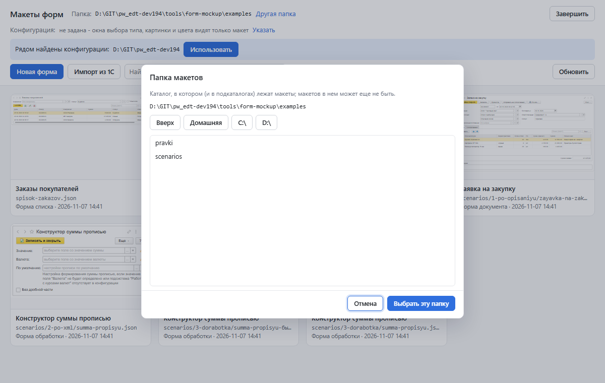
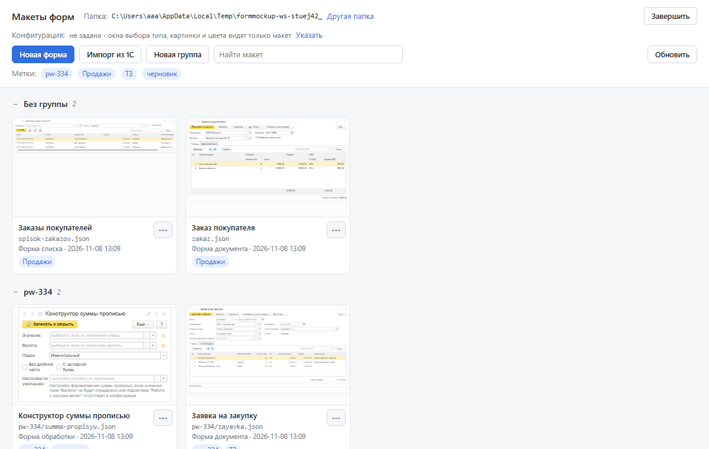
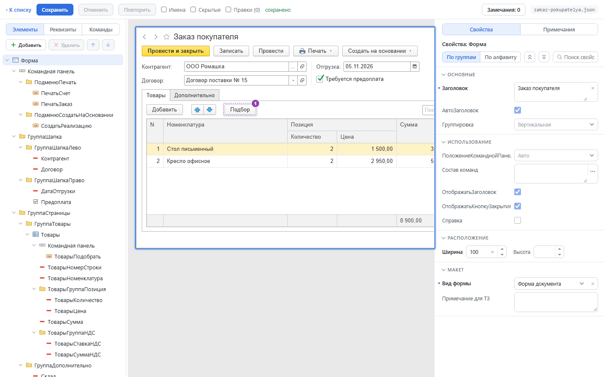

# Макеты форм 1С

Инструмент рисует управляемые формы 1С для технических заданий: картинка формы в интерфейсе
«Такси», страница HTML и таблица элементов. Макет - файл `.json` с описанием формы; его правят
в конструкторе в браузере, как форму в конфигураторе.

Агенту (Claude Code, Codex) инструмент описан в скилле `.claude/skills/form-mockup/SKILL.md`.
Ниже - как открыть и поправить макеты самому, без терминала.

## Как открыть макет

Нужны Python 3.9 или новее и браузер Google Chrome (на Windows подойдет и Edge, он есть всегда).
Нет Python - ярлык скажет, где его взять.

### 1. Открыть папку с макетами

Ярлык лежит в этой папке: **`Открыть макеты.cmd`** на Windows, **`Открыть макеты.command`** на Mac.

- **Двойной щелчок** - откроется последняя папка с макетами. В первый раз ярлык попросит выбрать
  папку: найдите ее в окне выбора и нажмите «Выбрать эту папку».
- **Перетащить на ярлык папку** с макетами - откроется она; **перетащить файл макета** (`.json`) -
  откроется сразу этот макет.

Пока инструмент запускается, на Windows видна заставка «Макеты форм 1С»; затем откроется отдельное
окно со списком макетов папки и ее подкаталогов. Заставка (на Mac - окно Терминала) закрывается
сама; если в ней осталось сообщение об ошибке - прочитайте его, там сказано, что сделать.



Удобнее держать ярлык на рабочем столе. Windows: правая кнопка на `Открыть макеты.cmd` -
«Отправить» - «Рабочий стол (создать ярлык)». Mac: перетащите файл в Dock или на рабочий стол
с нажатыми Option и Command - появится псевдоним. Сам файл из этой папки не переносите: он
запускает инструмент рядом с собой.

### 2. Выбрать макет



Щелчок по карточке открывает макет в конструкторе. Здесь же:

- **Новая форма** - пустой макет: имя файла и вид формы;
- **Импорт из 1С** - макет по готовой форме: перетащите в окно файл `Form.xml` (выгрузка
  конфигуратора) или `Form.form` (EDT). Указана конфигурация - форму можно выбрать в дереве
  объектов. Закладка «Из папки макетов» - взять копию готового макета из папки другой задачи;
- **Новая группа** - подпапка для макетов; макеты на странице разложены по группам. У карточки
  кнопка «⋯»: **Метки** (например, номер задачи - по метке список фильтруется),
  **Переместить в** группу, **Копировать в** группу или в папку другой задачи;
- **Конфигурация** - папка, где лежат исходники конфигурации и ее расширений (проект EDT,
  воркспейс EDT, выгрузка конфигуратора): тогда окна выбора типа, картинки и цвета показывают всю
  конфигурацию. Выбирается одна конфигурация, ее расширения отмечаются сами, лишние можно снять.
  Если в папке только расширения, а их основа лежит в другом месте, удобнее выбрать папку, где есть
  и то и другое (обычно воркспейс EDT). Запоминается у папки;
- **Другая папка** - открыть другую папку с макетами.

### 3. Поправить, сохранить, закрыть



Слева - дерево элементов формы, реквизиты и команды, в середине - макет, справа - свойства
выделенного элемента. Элементы переносятся мышью; реквизит, перетащенный из «Реквизитов» в
дерево или прямо на макет, становится полем, команда из «Команд» - кнопкой (место вставки
подсвечивается). Форма шире окна прокручивается полосой внизу макета. Отменить - Ctrl+Z,
повторить - Ctrl+Y.

Несколько элементов выделяются щелчком с Ctrl (на Mac - Cmd), в дереве диапазон - щелчком или
стрелками с Shift. Их можно
удалить разом (Delete) и поправить общие свойства: значение, которое у выделенных разное, помечено
«разные значения», правка применяется ко всем.

- **Сохранить** (Ctrl+S, на Mac Cmd+S) - правки записываются в файл макета. Пока не сохранено,
  рядом с кнопками вверху написано «есть несохранённые правки».
- **К списку** - назад к списку макетов папки.
- **Закрыть** - просто закройте окно. Через минуту без открытых окон инструмент остановится сам.
  Сразу - кнопка «Завершить» в списке макетов; несохраненные правки она покажет до остановки.

## Если что-то не так

| Что видно | Что сделать |
| --- | --- |
| «Не найден Python 3.9 или новее» | поставить Python с <https://www.python.org/downloads/>; на Windows при установке отметить «Add python.exe to PATH» |
| «Chrome и Edge не найдены» | макеты откроются во вкладке обычного браузера - работать можно; для отдельного окна поставить Google Chrome |
| окно открылось, но пишет «нет связи с сервером» | инструмент остановлен (закрыты все окна больше минуты): открыть ярлык снова, несохраненные правки - сохранить после этого |
| ярлык открыл не ту папку | перетащить нужную папку на ярлык или «Другая папка» в списке |
| «порты 8190-8210 заняты» (их держат другие программы) | задать свой первый порт: в домашней папке, в подпапке `.form-mockup`, создать файл `config.json` с текстом `{"port": 9000}` (любое число от 1024 до 65514; инструмент возьмет его или один из следующих 20) и открыть ярлык снова. Домашняя папка - `C:\Users\<имя>` на Windows, `/Users/<имя>` на Mac. Для администратора то же - переменная окружения `FORMMOCKUP_PORT`, из терминала - ключ `serve --port` |
| другая ошибка | текст ошибки - в заставке (на Mac - в окне Терминала); подробности для разработчика - в файле `.form-mockup/serve.log` в домашней папке |

## Для разработчика

### Требования

- Python 3.9 или новее, только стандартная библиотека.
- Google Chrome или Chromium - для PNG и тестов страниц и снимков (запуск без окна). Ищется в
  стандартных местах установки и по `PATH`; другой путь - переменная `FORMMOCKUP_CHROME`. Без
  Chrome страницы и снимки рисует Microsoft Edge, если он есть.

### Устройство

| Каталог, файл | Что |
| --- | --- |
| `formmockup.py` | командная строка |
| `fmlib/` | модель и ее проверка, импорт EDT и конфигуратора, сравнение «было / стало», рендер, сервис и конструктор |
| `render/` | страница макета, конструктор и список макетов: HTML, JS, CSS |
| `schema/` | схема модели, справочник видов и свойств `model.md`, словарь русских названий, цвета платформы |
| `examples/` | примеры моделей и сценарии работы агента |
| `1c/` | скрипты для 1С: выгрузка стандартных картинок платформы, таблица `Формат()` для теста конструктора |
| `tests/` | тесты `unittest` и фикстуры |
| `Открыть макеты.cmd`, `Открыть макеты.command` | ярлыки запуска для пользователя (Windows, Mac) |

### Командная строка

Пути - от корня репозитория; на Windows вместо `python3` - `python` или `py -3`.

```text
python3 tools/form-mockup/formmockup.py import <Form.form|Form.xml> -o <модель.json>   модель по XML формы и отчет импорта
python3 tools/form-mockup/formmockup.py check  <модель.json>                           проверка модели
python3 tools/form-mockup/formmockup.py render <модель.json> -o <каталог> [--png] [--before <было.json>]
                                                                                        HTML, PNG, замечания раскладки
python3 tools/form-mockup/formmockup.py table  <модель.json> [--before <было.json>]    таблица элементов или изменений, Markdown
python3 tools/form-mockup/formmockup.py compare <макет.json> <Form.form|Form.xml|модель.json>
                                                                                        сверка собранной формы с макетом, Markdown
python3 tools/form-mockup/formmockup.py ru     <слово> [...]                           перевод имен видов и свойств
python3 tools/form-mockup/formmockup.py serve  <папка|модель.json> [--src <исходники>] [--port N]
                                                                                        сервис макетов и конструктор в браузере
```

Коды возврата: 0 - чисто; 1 - замечания модели или раскладки, у `compare` - отличия формы от макета; 2 - файл не читается, порт занят
или каталог не исходники конфигурации; 3 - нужен PNG, а Chrome нет. Все ключи - в шапке
`formmockup.py` и `formmockup.py <команда> -h`.

Для агента сценарии работы (форма по описанию, по XML, доработка «было / стало», сверка собранной формы с макетом), правила вёрстки
и разбор ответов инструмента описаны в скилле `.claude/skills/form-mockup/SKILL.md`.

### Переменные окружения

| Переменная | Что задает |
| --- | --- |
| `FORMMOCKUP_CHROME` | путь к Chrome или Chromium вне стандартных мест |
| `FORMMOCKUP_STD_PICTURES` | своя выгрузка стандартных картинок (каталог или zip) вместо `std-pictures.zip`; то же - ключ `--std-pictures` |
| `FORMMOCKUP_PORT` | первый порт сервиса вместо 8190; важнее `port` в `~/.form-mockup/config.json` |
| `FORMMOCKUP_CORPUS` | тесты: корни исходников (`.../src`) через разделитель путей ОС - каждая форма импортируется без падения и без нераспознанного |
| `FORMMOCKUP_PAIRS` | тесты: пара `<src EDT><разделитель><src выгрузки>` одной конфигурации - одна форма из двух форматов дает одну модель |
| `FORMMOCKUP_BASELINE=update` | тесты: снять эталон снимков заново |

### Тесты

```text
python3 -m unittest discover -s tools/form-mockup/tests
```

На Windows - `python -X utf8 -m unittest discover -s tools/form-mockup/tests`: иначе сообщения
раннера идут в кодировке консоли. Без Chrome тесты страниц и снимков пропускаются; тесты ярлыка
`.cmd` и заставки идут только на Windows.

Эталон снимков `render` - хеши PNG в `tests/fixtures/baseline-<ОС>.json` (`darwin`, `win32`). Он
привязан к ОС и версии Chrome: на другой версии, на Edge или без эталона своей ОС тест пропускается
с подсказкой. Снять эталон заново (новая версия Chrome или осознанная правка вида):

```text
FORMMOCKUP_BASELINE=update python3 -m unittest discover -s tools/form-mockup/tests -p test_baseline.py
```

Снятые снимки остаются в `tests/fixtures/baseline-<ОС>/` (каталог в `.gitignore`) для сверки по
пикселям на этой машине.

## Источник

Инструмент сделан в проекте [PrintWizard](https://github.com/vandalsvq/printwizard), где
рисует формы для технических заданий; в шаблон перенесена его универсальная часть.

## Сторонние материалы

Значки видов метаданных в дереве «Из конфигурации» (`render/metadata-icons.json`) взяты из
общих картинок Библиотеки стандартных подсистем 1С (БСП) 3.1.7, Copyright (c) ООО «1С-Софт»,
лицензия [Attribution 4.0 International (CC BY 4.0)](https://creativecommons.org/licenses/by/4.0/legalcode).
Изменения: картинки собраны в один файл JSON в виде data URI, рисунки не менялись.

Стандартные картинки платформы (`std-pictures.zip`) выгружены из платформы 1С:Предприятие 8
скриптом `1c/ВыгрузитьСтандартныеКартинки.bsl` и включены для совместимости: макет показывает
кнопки и поля с теми же картинками, что и форма в 1С. Права на них принадлежат фирме «1С»,
лицензия MIT на них не распространяется. Свою выгрузку (другая версия платформы) инструмент
берет вместо архива: каталог или zip - ключом `--std-pictures` или переменной
`FORMMOCKUP_STD_PICTURES`.
